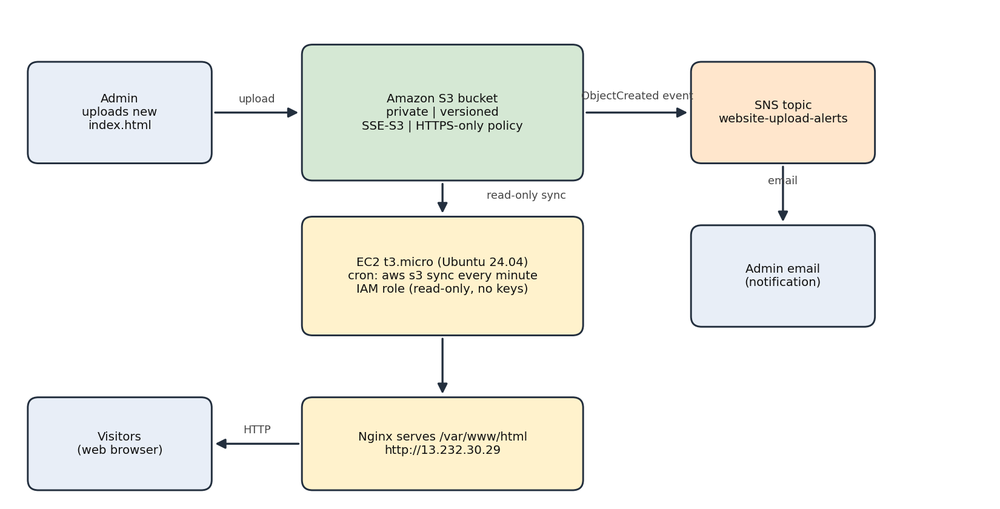
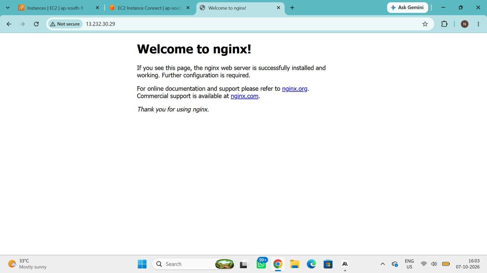
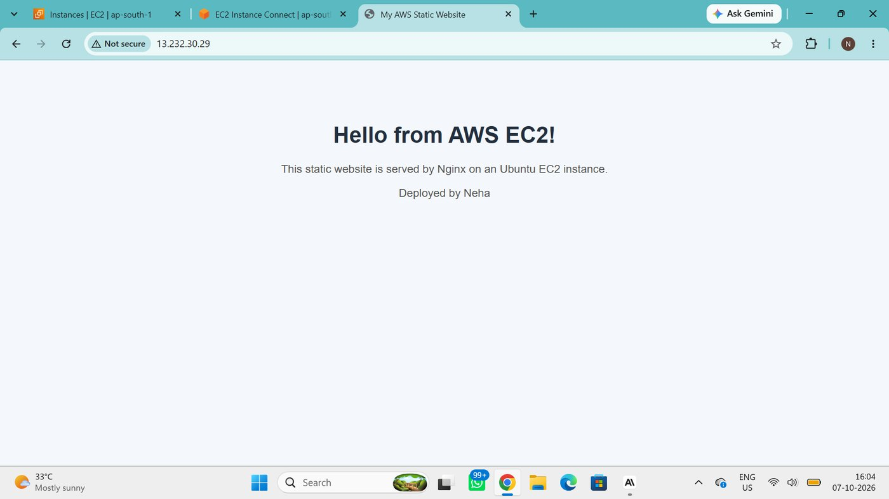
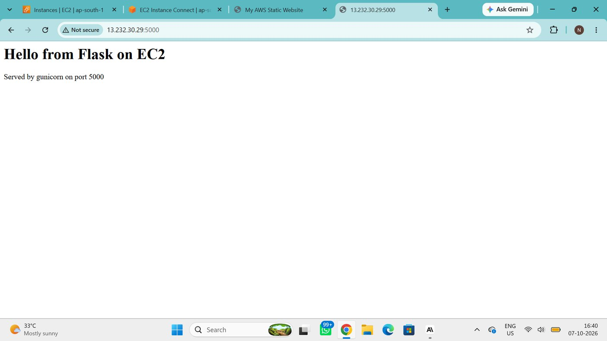
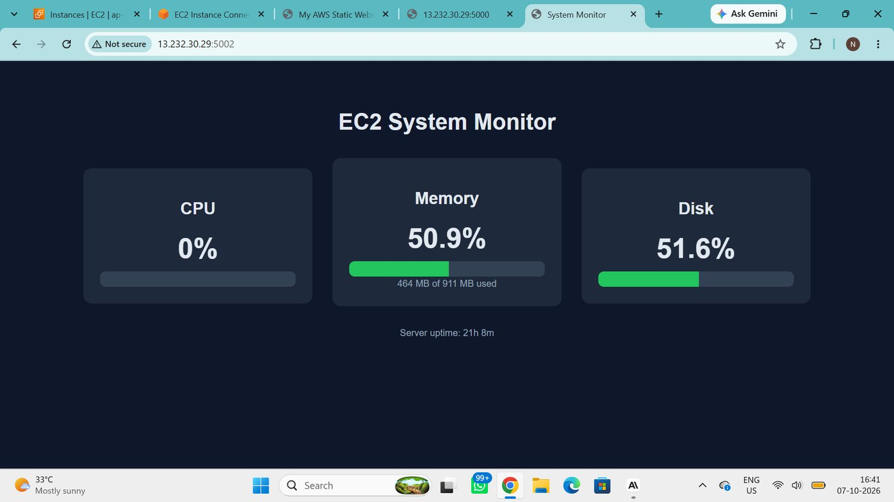
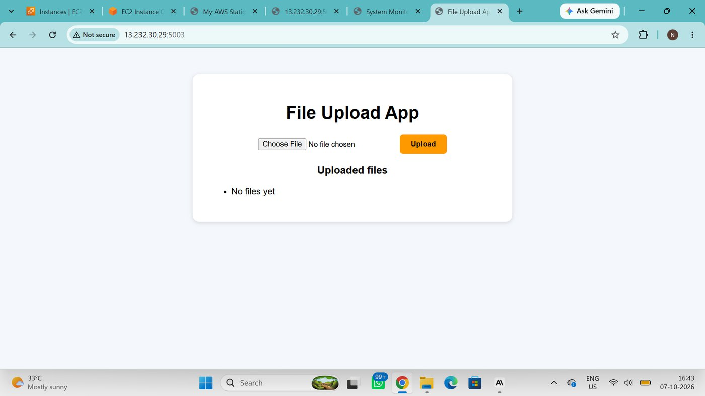
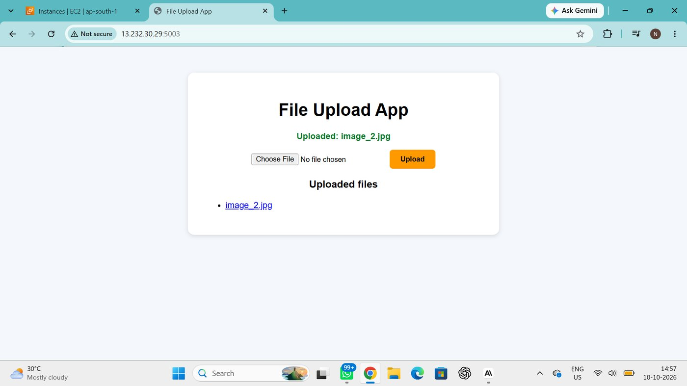

# AWS Cloud Projects

Five minor projects and one major project built for an AWS and cloud computing course.
Everything runs in the **Asia Pacific (Mumbai) `ap-south-1`** region on a single Ubuntu 24.04 EC2 instance (`t3.micro`).

| # | Project | Tech | Port |
|---|---------|------|------|
| Minor 1 | Static website on EC2 | Nginx | 80 |
| Minor 2 | Flask app | Flask + Gunicorn | 5000 |
| Minor 3 | System monitor dashboard (CPU, memory, disk) | Flask + psutil | 5002 |
| Minor 4 | File upload app | Flask | 5003 |
| Minor 5 | Auto-start on boot | systemd | n/a |
| **Major** | **Secure static website hosting with upload notifications** | S3, SNS, EC2, IAM, Nginx | 80 |

---

## Major project: secure static website with notifications

A company website is stored in a **private S3 bucket**, served to visitors by an **EC2 web server (Nginx)**, and the administrator gets an **email whenever new content is uploaded**.



### How it works

1. The admin uploads `index.html` to the S3 bucket.
2. S3 raises an `ObjectCreated` event and sends it to the SNS topic `website-upload-alerts`.
3. SNS emails the administrator (email subscription, confirmed).
4. A cron job on EC2 runs `aws s3 sync` every minute and copies the bucket to `/var/www/html`.
5. Nginx serves the files, so the live site updates within about a minute.

### Security measures

| Measure | Detail |
|---|---|
| Private bucket | **Block all public access** is on |
| Encryption at rest | Default encryption **SSE-S3** |
| Encryption in transit | Bucket policy denies any request where `aws:SecureTransport` is `false` |
| Versioning | Enabled, so every upload keeps a recoverable version |
| Least privilege | EC2 uses an IAM role with only `s3:ListBucket` and `s3:GetObject` on this one bucket |
| No stored credentials | The role gives temporary credentials. No access keys are on the server |
| Scoped SNS access | Only S3 (from this bucket) may publish to the topic |

### Setup steps

1. **SNS**: create a Standard topic `website-upload-alerts`, add an email subscription and confirm it from the email. Add the statement from [`sns-access-policy.json`](major-project/policies/sns-access-policy.json) to the topic's existing access policy (*Access policy* tab > *Edit*). Keep the default statement that is already there.
2. **S3**: create a bucket in `ap-south-1`. Keep *Block all public access* on, enable *Versioning*, set default encryption to *SSE-S3*, and apply [`bucket-policy.json`](major-project/policies/bucket-policy.json).
3. **Event notification**: on the bucket's *Properties* tab, create `new-content-upload` for *All object create events* with the SNS topic as the destination. S3 sends a test email when it is saved.
4. **IAM**: create a role for EC2 using [`iam-ec2-trust-policy.json`](major-project/policies/iam-ec2-trust-policy.json), add the inline policy [`iam-read-website-bucket.json`](major-project/policies/iam-read-website-bucket.json), and attach the role to the instance.
5. **EC2 web server**:
   ```bash
   sudo apt update && sudo apt install nginx -y
   sudo snap install aws-cli --classic
   sudo cp major-project/scripts/s3-sync.cron /etc/cron.d/s3-sync   # edit the bucket name first
   ```
6. **Test**: upload [`index.html`](major-project/website/index.html) to the bucket. Check that the email arrives and that `http://<EC2-public-IP>` shows the page. Upload a changed version and check the *Versions* tab shows two versions.

Replace `<ACCOUNT_ID>` in the policy files with your own AWS account ID before using them.

---

## Minor projects

### Setup used for all of them

```bash
sudo apt update
sudo apt install -y nginx python3-venv python3-pip
mkdir -p ~/aws-projects && cd ~/aws-projects
python3 -m venv venv
source venv/bin/activate
pip install -r requirements.txt
```

Open the needed ports (80, 5000, 5002, 5003) in the EC2 security group.

### Minor 1: static website with Nginx

Install Nginx, then replace the default page in `/var/www/html/index.html` with your own HTML.

| Default page | Custom page |
|---|---|
|  |  |

### Minor 2: Flask app

Code: [`flask-app/app.py`](flask-app/app.py). Run it with:

```bash
cd ~/aws-projects/flask-app
~/aws-projects/venv/bin/gunicorn -b 0.0.0.0:5000 app:app
```



### Minor 3: system monitor dashboard

Code: [`monitor-app/app.py`](monitor-app/app.py). The page calls `/api/stats` every 2 seconds and shows CPU, memory, disk and uptime using `psutil`.



### Minor 4: file upload app

Code: [`upload-app/app.py`](upload-app/app.py). Uses `secure_filename` and a 10 MB upload limit. Uploaded files are listed on the page and can be downloaded.

| Before upload | After upload |
|---|---|
|  |  |

### Minor 5: auto-start with systemd

The three apps run as services: [`flask-app.service`](systemd/flask-app.service), [`monitor-app.service`](systemd/monitor-app.service) and [`upload-app.service`](systemd/upload-app.service).

```bash
sudo cp systemd/*.service /etc/systemd/system/
sudo systemctl daemon-reload
sudo systemctl enable --now flask-app monitor-app upload-app
systemctl is-active  flask-app monitor-app upload-app
systemctl is-enabled flask-app monitor-app upload-app
```

After `sudo reboot`, all three apps came back by themselves. The `Restart=always` setting also restarts a service if it crashes.

---

## Repository structure

```
aws-cloud-projects/
├── README.md
├── requirements.txt
├── .gitignore
├── flask-app/app.py
├── monitor-app/app.py
├── upload-app/app.py
├── systemd/
│   ├── flask-app.service
│   ├── monitor-app.service
│   └── upload-app.service
├── major-project/
│   ├── website/index.html
│   ├── policies/            (bucket, SNS, IAM JSON files)
│   └── scripts/s3-sync.cron
└── docs/images/
```

## Known limitations and improvements

- The site is served over HTTP. For production, put CloudFront with an ACM certificate in front.
- The security group allows several ports from anywhere. Restrict SSH (port 22) to your own IP.
- A cron sync has up to a one-minute delay. An S3 event to Lambda could update the server instantly.
- Use an IAM user with MFA for daily work instead of the root account.

## Security note

Never commit private keys (`*.pem`), access keys or account-specific values. The `.gitignore` already blocks `*.pem`.
